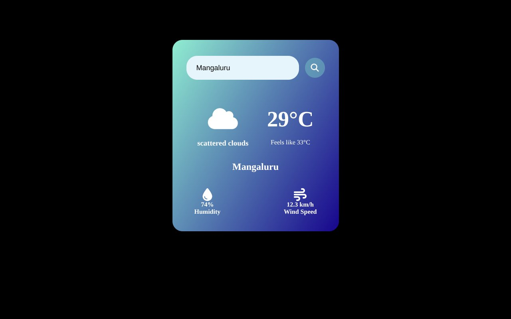

# Weather Website

Type a city or state to see the current temperature, conditions, feels-like, humidity and wind speed from the OpenWeatherMap API.

**Live:** https://jeevan2410.github.io/Weather-Website/

## Built with

Plain HTML, CSS and JavaScript, with the OpenWeatherMap current weather API and Font Awesome icons.

## Run it locally

Open `index.html` in a browser.
